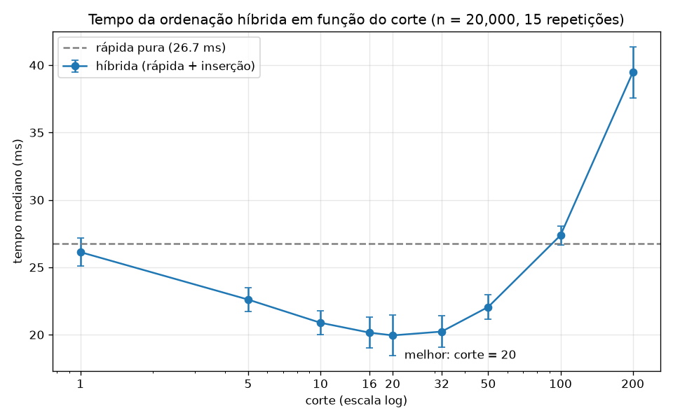

# Ordenação híbrida: rápida + inserção

## O que foi feito

- **`ordenacao.py`**
  - `rapida(v)`: ordenação rápida pura, com pivô aleatório (`random.choice`) e partição em três listas: **menores**, **iguais** e **maiores** que o pivô.
  - `insercao(v)`: ordenação por inserção.
  - `hibrida(v, corte)`: a mesma ordenação rápida, mas quando o pedaço tem **menos que `corte` elementos** ela passa a usar a inserção.
- **`medir.py`**: mede o tempo com **20 000 inteiros aleatórios** para os cortes 1, 5, 10, 16, 20, 32, 50, 100 e 200, e também para a rápida pura. Grava `resultados.csv` e `grafico.png`.

Como medimos:

- 15 vetores aleatórios (semente 42, valores entre 0 e 200 000). Todas as variantes ordenam **as mesmas** 15 entradas.
- Usamos a **mediana** das 15 execuções, porque ela sofre menos com picos ocasionais do sistema. A tabela também mostra o desvio-padrão.
- Antes de medir, rodamos a rápida 3 vezes para aquecer o interpretador.
- Toda saída é comparada com `sorted()` para confirmar que a ordenação está correta.
- Ambiente: Python 3.13, Windows 11.

Para reproduzir: `python medir.py`

## Resultados

| Corte | Tempo mediano (ms) | Desvio-padrão (ms) | Em relação à rápida pura |
|---:|---:|---:|---:|
| rápida pura | 26,73 | 1,60 | — |
| 1   | 26,13 | 1,02 | −2,2 % (ruído) |
| 5   | 22,60 | 0,89 | −15,5 % |
| 10  | 20,89 | 0,89 | −21,8 % |
| 16  | 20,15 | 1,16 | −24,6 % |
| **20** | **19,95** | 1,49 | **−25,4 %** |
| 32  | 20,23 | 1,16 | −24,3 % |
| 50  | 22,06 | 0,89 | −17,5 % |
| 100 | 27,37 | 0,70 | +2,4 % |
| 200 | 39,46 | 1,90 | +47,6 % |

## Qual corte deu o melhor tempo

O melhor tempo foi com **corte = 20**: **19,95 ms**, contra 26,73 ms da rápida pura. Isso é **25 % mais rápido** (cerca de 1,34 vez mais veloz).

Os cortes 16, 20 e 32 ficaram praticamente iguais, com menos de 0,3 ms de diferença, bem menos que o desvio-padrão. Na prática, a curva tem um "vale" largo entre 10 e 50, e qualquer corte entre **16 e 32** é ótimo. É a mesma faixa que bibliotecas reais usam. Por exemplo, o introsort do C++ usa 16.

Por que a combinação ganha: nos pedaços pequenos, a rápida gasta mais com a própria estrutura do que com a ordenação em si. A cada chamada ela sorteia o pivô, cria três listas novas, percorre o pedaço três vezes e concatena tudo. A inserção não cria nada: ela só faz comparações e deslocamentos no lugar. Quando o pedaço é pequeno, o custo quadrático da inserção ainda é baixo, e por isso ela sai na frente.

## O que acontece com cortes grandes demais

A partir de um certo ponto, o custo **O(k²)** da inserção começa a pesar mais do que a economia de chamadas.

- Com **corte = 100**, a híbrida já fica um pouco **mais lenta** que a rápida pura (+2 %). A vantagem acabou.
- Com **corte = 200**, ela fica **48 % mais lenta** que a pura e quase 2 vezes mais lenta que o melhor corte.

O motivo: um pedaço de tamanho *k* custa cerca de *k²/4* comparações na inserção. A rápida, no mesmo pedaço, faz cerca de *k·log k*. Para *k* pequeno, a diferença entre os dois é pequena e as constantes da rápida dominam. Para *k* grande, o termo quadrático domina. No extremo, se o corte fosse maior que *n*, o algoritmo inteiro viraria uma ordenação por inserção, que é O(n²).

## Confirmação: corte = 1 se comporta como a rápida pura

Com corte = 1, a condição `len(v) < corte` só seria verdadeira para um pedaço vazio. Mas o caso base `len(v) <= 1` já trata esse caso antes. Então **a inserção nunca é chamada**, e `hibrida(v, 1)` executa exatamente os mesmos passos que `rapida(v)`.

As medições confirmam isso:

- corte = 1: **26,13 ms ± 1,02**
- rápida pura: **26,73 ms ± 1,60**

A diferença é de 0,6 ms, menor que o desvio-padrão das duas medições, ou seja, é ruído. Em uma primeira rodada, sem o aquecimento, a ordem tinha até se invertido: 24,85 ms para corte = 1 contra 24,56 ms para a pura. Isso reforça que as duas são equivalentes.
